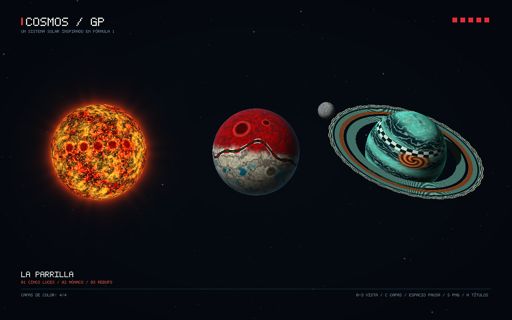
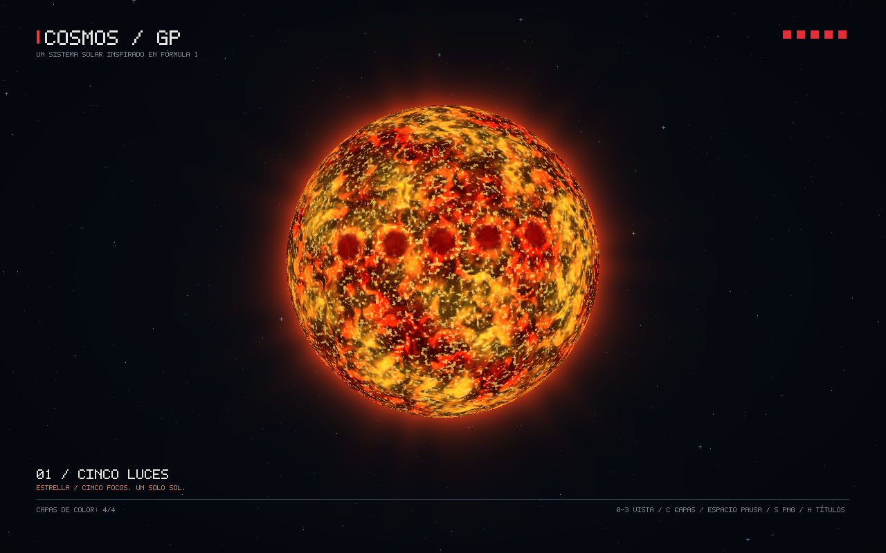
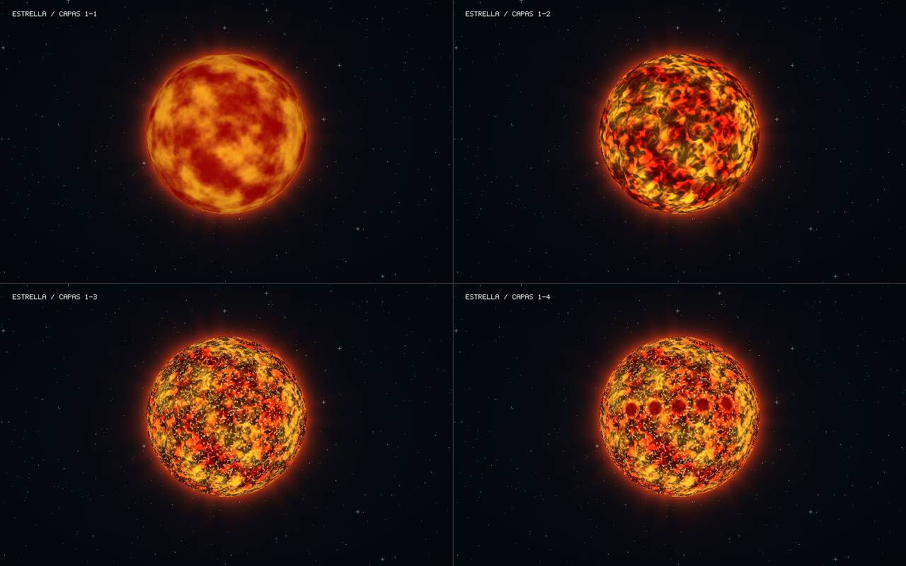
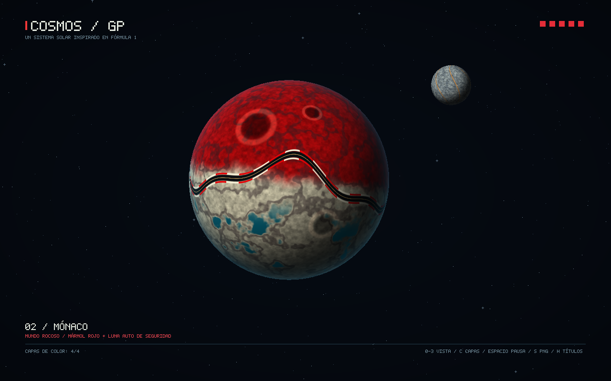
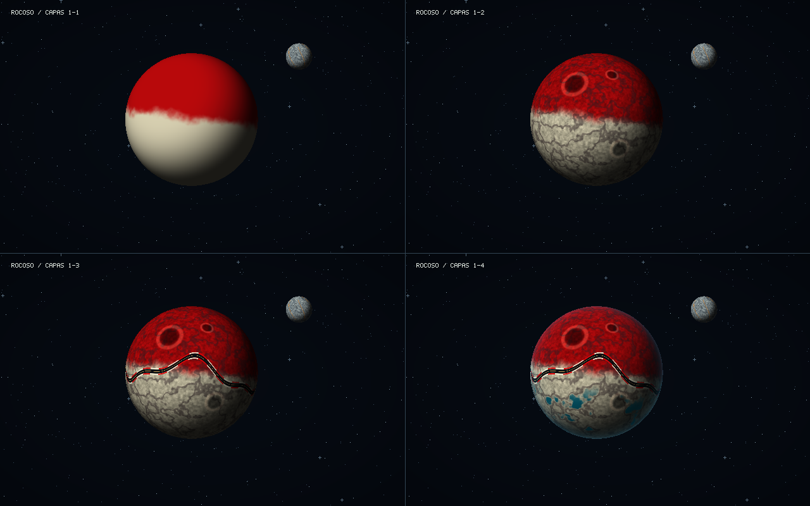
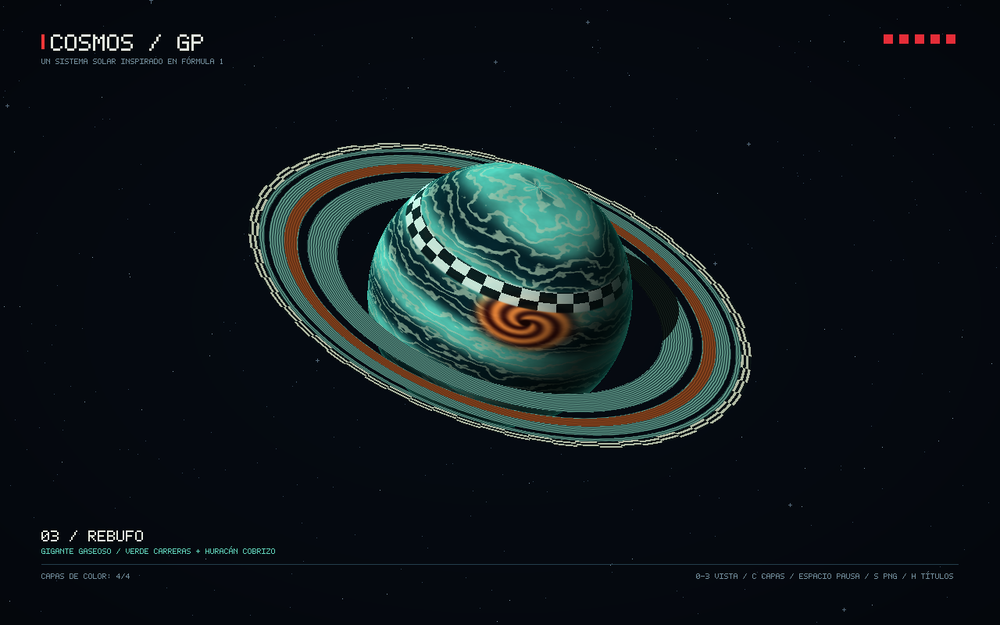
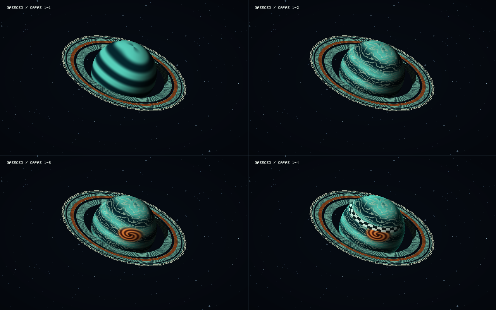

# COSMOS / GP 🏁

Un sistema solar inspirado en Fórmula 1, renderizado en CPU con Rust. Cinco luces de salida se convierten en una estrella; Mónaco, en un planeta de mármol rojo y marfil con un circuito; el rebufo, en un gigante gaseoso verde con una tormenta cobriza y anillos a cuadros.

Los colores de los cuerpos, la luna y los anillos se calculan por fragmento. **Sin texturas, archivos de materiales ni mapas de color precalculados.** Las imágenes de este README son exportaciones auténticas del framebuffer del programa.



## Ejecutar

Requiere Rust y Cargo. Desde la carpeta del repositorio:

```bash
cargo run --release --locked
```

Para abrir directamente un cuerpo:

```bash
cargo run --release --locked -- --escena estrella
cargo run --release --locked -- --escena rocoso
cargo run --release --locked -- --escena gaseoso
```

La ventana inicia animada. La estrella y los planetas rotan; el plasma y las tormentas evolucionan con el tiempo. La luna rota y se traslada alrededor de Mónaco. Los tres cuerpos principales se presentan juntos en una composición de exhibición, sin simular órbitas planetarias alrededor del sol.

| Tecla | Acción |
|---|---|
| `0` | Sistema completo |
| `1` | Estrella Cinco Luces |
| `2` | Planeta rocoso Mónaco y su luna |
| `3` | Gigante gaseoso Rebufo y sus anillos |
| `Tab` | Siguiente vista |
| `C` | Recorrer las cuatro capas acumulativas del shader |
| `Espacio` | Pausar o reanudar el tiempo |
| `R` | Reiniciar el tiempo a cero |
| `H` | Mostrar u ocultar títulos y controles |
| `S` | Guardar exactamente el framebuffer visible |
| `Esc` | Cerrar |

La ruta predeterminada de exportación es `renders/captura.png`, relativa al directorio desde donde se ejecuta. `--salida` permite cambiarla. Usa `--pausado` para iniciar sin movimiento y `--ayuda` para consultar todas las opciones.

## Los cuerpos y sus cuatro capas

Las capas se acumulan en orden: `1`, `1+2`, `1+2+3` y `1+2+3+4`. Cada una modifica el color de la superficie, además de la iluminación. El control `C` permite demostrarlo durante la ejecución. Las hojas comparativas muestran el mismo instante (`t = 0`), encuadre y geometría.

### 01 · Cinco Luces, la estrella

La salida de una carrera se vuelve un sol de plasma naranja, con cinco focos magnéticos rojos que giran junto con su superficie. Su emisión mantiene la estrella visible sin un hemisferio nocturno.



| Capa | Cálculo y efecto visible |
|---|---|
| 1 · Temperatura | Ruido fractal 3D de cuatro octavas mezcla rojo oscuro, naranja y amarillo. El tiempo desplaza el campo térmico. |
| 2 · Pliegues de plasma | Un segundo ruido deforma el dominio de otro campo fractal. Aparecen grandes corredores oscuros y pliegues encendidos. |
| 3 · Granulación | Ruido de mayor frecuencia introduce pequeños núcleos amarillos y blancos entre las estructuras grandes. |
| 4 · Luces magnéticas | Cinco distancias a centros sobre la esfera generan manchas rojas con bordes calientes. Se suma un borde emisivo. |

El halo exterior se calcula aparte, analíticamente en pantalla; **no se cuenta como una de las cuatro capas de la superficie**.



### 02 · Mónaco, el planeta rocoso

Dos hemisferios geológicos recuerdan los colores de Mónaco. El circuito recorre la esfera con asfalto oscuro, una línea central dorada y pianos alternados en rojo y blanco. Los puertos turquesa y la luna Auto de Seguridad completan el concepto.



| Capa | Cálculo y efecto visible |
|---|---|
| 1 · Hemisferios | La latitud y el ruido de baja frecuencia separan mármol rojo y marfil con una frontera irregular. |
| 2 · Geología | Ruido fractal fino, vetas oscuras y distancias a centros de impacto añaden regolito, fracturas y cráteres con bordes claros. |
| 3 · Circuito | Una función periódica de longitud y latitud traza el asfalto; máscaras de distancia definen la línea y los pianos alternados. |
| 4 · Costa y atmósfera | Umbrales del campo de terreno forman pequeñas cuencas turquesa. Un término de borde añade brillo atmosférico azul. |

El trazado es una interpretación artística; no reproduce el circuito real de Mónaco. El relieve se sugiere con el color, conservando la geometría esférica.



### 03 · Rebufo, el gigante gaseoso

Verde de carreras, bandas de velocidad y una franja de meta a cuadros. Un huracán cobrizo rompe las bandas y conecta visualmente con el carril de cobre de los anillos.



| Capa | Cálculo y efecto visible |
|---|---|
| 1 · Bandas | Funciones sinusoidales de latitud y longitud mezclan verde petróleo y turquesa. |
| 2 · Turbulencia | Ruido fractal anisótropo de cuatro octavas deforma bandas finas y añade filamentos plateados que evolucionan con el tiempo. |
| 3 · Huracán | Una máscara elíptica, coordenadas polares y brazos espirales generan la tormenta cobriza y su ojo oscuro. |
| 4 · Meta y atmósfera | Paridad de celdas de longitud y latitud produce una estrecha franja a cuadros. El borde atmosférico aporta brillo verde. |



## Anillos y luna

**Los anillos son una malla anular independiente** de 256 segmentos y 512 triángulos, inclinada con respecto a la cámara. Su shader calcula surcos radiales de neumático, una banda cobriza, un carril exterior a cuadros y dos huecos. Los huecos descartan fragmentos antes de escribir profundidad, por lo que no tapan lo que queda detrás.

El z-buffer resuelve qué partes del anillo pasan por delante y cuáles quedan detrás del planeta. Además, se calculan la sombra de la esfera sobre los anillos y la del plano de anillos sobre la esfera mediante intersecciones analíticas hacia la luz. La iluminación es artística y direccional.

**Auto de Seguridad es una segunda malla de esfera**, con su propia transformación, escala, rotación y órbita alrededor de Mónaco. Su shader combina regolito gris, pequeñas marcas de impacto, meridianos ámbar y un borde azulado. Se usa una geometría separada de la del planeta, tal como exige el laboratorio.

## Relación con la rúbrica

| Criterio | Evidencia implementada | Puntos de la rúbrica |
|---|---|---:|
| Creatividad | Sistema temático de F1; luces de salida, circuito, pianos, meta, surcos y luna Auto de Seguridad | Hasta 30, valoración subjetiva |
| Complejidad de shaders | Cuatro capas de color por cada cuerpo requerido, demostrables con `C` y las tres hojas comparativas | Hasta 40 |
| Planetas adicionales | No se incluyen; la luna se presenta como luna | 0 |
| Anillos | Malla separada, shader procedural, huecos, oclusión y sombras | 20 |
| Luna | Malla separada, shader propio, rotación y traslación | 20 |
| Rotación y traslación opcionales | Rotación de los cuerpos y órbita de la luna, controladas por tiempo | Implementadas |

La nota máxima indicada por el enunciado es **100**, aunque la suma de criterios posibles sea mayor. Esta tabla documenta la implementación; la evaluación artística y la asignación de puntos corresponden al docente.

## Exportar y reproducir las capturas

```bash
# Todas las imágenes del README, comparaciones y candidato al concurso
bash scripts/generar-galeria.sh

# Un cuerpo sin abrir una ventana
cargo run --release --locked -- --solo-render --escena rocoso --tiempo 0 --salida renders/mi-monaco.png

# Comparación de capas acumulativas en una sola imagen
cargo run --release --locked -- --escena gaseoso --tiempo 0 --comparar-capas --salida renders/comparacion.png

# Exportación sin títulos, en otro instante
cargo run --release --locked -- --solo-render --escena estrella --tiempo 8 --sin-titulos --salida renders/plasma.png
```

También se puede ejecutar sin dependencias de ventana:

```bash
cargo run --release --locked --no-default-features -- --solo-render --escena sistema
```

Los campos de ruido y las estrellas de fondo son deterministas. A igual resolución, vista, tiempo y número de capas, el programa reproduce la misma imagen en el mismo entorno. `image` solo codifica PNG; no carga imágenes para colorear los cuerpos. La tipografía del panel se dibuja en el framebuffer y no interviene en los shaders de las superficies.

### Candidato al concurso

Recomiendo **Rebufo**: combina la tormenta cobriza, los cuadros y los anillos con una silueta reconocible. La imagen preparada está en [renders/concurso-rebufo.png](renders/concurso-rebufo.png), a **1920 × 1200**. No se publica automáticamente en Discord.

```bash
cargo run --release --locked -- --solo-render --escena gaseoso --tiempo 0 --ancho 1920 --alto 1200 --salida renders/concurso-rebufo.png
```

## Cómo funciona

```text
Mallas indexadas de esfera / anillos / luna
    → transformación del modelo y normales
    → proyección ortográfica a pantalla
    → recorrido de caras y sus tres índices
    → coordenadas baricéntricas por píxel
    → interpolación de posición local, posición global y normal
    → prueba de profundidad
    → shader procedural de color, o descarte
    → framebuffer RGB 0xRRGGBB y profundidad
    → ventana minifb o exportación PNG del mismo buffer
```

Se generan las esferas trianguladas por código, sin depender del modelo de Canvas. La esfera principal tiene 10 114 vértices y 20 224 triángulos; la luna, 2 498 vértices y 4 992 triángulos. Los shaders usan posición local para mantener los patrones unidos a la superficie, normal interpolada para iluminación y borde, posición global para sombras y tiempo para animación. La proyección ortográfica permite interpolación baricéntrica afín sin corrección de perspectiva. Las normales se transforman por rotación, válida aquí porque las escalas de modelo son uniformes.

| Archivo | Responsabilidad |
|---|---|
| `src/mesh.rs` | Generación de mallas indexadas independientes |
| `src/framebuffer.rs` | Rasterización baricéntrica, interpolación, z-buffer, descarte y PNG |
| `src/noise.rs` | Ruido 3D continuo y ruido fractal de varias octavas |
| `src/shader.rs` | Capas de los cinco shaders y sombras de los anillos |
| `src/render.rs` | Escenas, transformaciones, cámara, fondo y halo |
| `src/hud.rs` | Letras geométricas y panel en español |
| `src/main.rs` | Opciones, ventana, teclado y exportación |
| `tests/` | Pruebas de geometría, interpolación, profundidad, shaders y CLI |

La base del recorrido por índices, las coordenadas baricéntricas, el z-buffer y la exportación RGB proviene de [lab-4](https://github.com/yehosuah/lab-4), commit `f33aa247054d7dc883be9fd13d04b015a5d4fa0d`. Este repositorio mantiene una entrega independiente. Aquí el color por cara y los materiales MTL se sustituyen por funciones procedurales por fragmento.

## Verificar

```bash
cargo fmt --check
cargo clippy --locked --all-targets -- -D warnings
cargo test --locked
cargo clippy --locked --no-default-features --all-targets -- -D warnings
cargo test --locked --no-default-features
```

Las ocho pruebas cubren interpolación baricéntrica en ambos sentidos del triángulo, profundidad independiente del orden, descarte sin oclusión, recorte y entradas inválidas, esfera cerrada con caras orientadas hacia afuera, cambios visibles entre capas, animación reproducible, mallas separadas, huecos y sombra del anillo, validación de opciones y coincidencia píxel por píxel entre PNG y framebuffer. La integración continua ejecuta las comprobaciones sin ventana en Linux.
